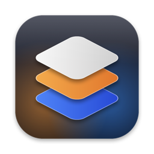

<p align="center">
  
</p>

<h1 align="center">TopLayer</h1>

<p align="center">
  A macOS overlay that sits above every app, fullscreen ones included,<br>
  and lets you follow and answer your Claude Code and Codex threads without switching apps.
</p>

<p align="center">
  
  
  
  
  <a href="LICENSE"></a>
</p>

---

TopLayer shows a small squircle in a corner of the screen. Click it, or press ⌃⌥Space, and it opens into a panel with your running Claude sessions and recent Codex threads.

- 👀 **Follow** a thread as it updates, from any app
- 💬 **Reply** to it without leaving what you are doing
- ✅ **Approve or deny** permission prompts with ⌘↩ and ⌘.
- ➕ **Start** new Codex threads and Claude sessions, with the folder, model and effort you pick
- 🤝 **Link** a Claude session and a Codex thread in a group chat, so the two agents message each other under limits you set
- 📊 **See plan usage** for both, as a ring in each section's header
- 🌐 **Open** each product's own web client inside the overlay

This is a personal tool at version 0.1. It depends on parts of Claude Code and Codex that are not official interfaces (see [What it relies on](#what-it-relies-on)), so an update to either can break it.

## Requirements

- macOS 26 or later
- Swift toolchain (the Xcode Command Line Tools are enough to build; the tests need full Xcode)
- [Claude Code](https://claude.com/claude-code), desktop app or CLI
- The Codex CLI. TopLayer talks to its background service (the app-server daemon) and starts it when it is not running

## Build and install

There is no download: you build it on the Mac that runs it, which takes about a minute.

Clone this repository, then from its folder:

```bash
Scripts/build-app.sh --launch
```

This builds a release, assembles `TopLayer.app`, signs it, installs it to `/Applications`, copies the helper scripts to `~/.toplayer/bin`, and starts it. Without `--launch` it does everything except start it. An app built on your own Mac is not held back by Gatekeeper, so there is nothing to approve in System Settings.

Run the script from a terminal of your own, not through a coding agent: see [TopLayer was started by an agent](TROUBLESHOOTING.md#toplayer-was-started-by-an-agent).

**Updating.** `git pull`, then the same script again. It replaces the installed app and the helper scripts; your settings, hooks and group chats stay.

**Signing.** macOS remembers what you allowed an app to do (a keychain item, a privacy permission) by who signed it, so the build signs with the first of these it finds:

1. the identity named in `TOPLAYER_SIGN_IDENTITY`
2. a certificate Apple issued to you: *Developer ID Application*, then *Apple Development* (Xcode creates one when you sign in with an Apple account under Settings → Accounts)
3. a self-signed certificate named `TopLayer Local Signing`
4. nothing: an ad-hoc signature

With the first three, what you allowed carries over from build to build. Ad-hoc signed, the app works, but every build is a different app to macOS and is asked again. Changing from one kind to another counts as a new signer, so expect to be asked once more after the change.

Which one to pick:

- **An Apple Development certificate** is the one to prefer, and a free Apple account is enough. In Xcode, open Settings → Accounts, add your account, then Manage Certificates → + → Apple Development. The build finds it by itself.
- **A self-signed certificate** needs no account. In Keychain Access, choose Keychain Access → Certificate Assistant → Create a Certificate…, name it `TopLayer Local Signing`, and set Certificate Type to Code Signing. Privacy permissions then carry over, but the web panes' keychain item may still ask for your password after a build.
- **Nothing** works too. Expect the web panes to ask for your password after every build.

With either certificate, the first build stops while macOS asks whether `codesign` may use the certificate's key: press **Always Allow**. Both password questions are explained in [TROUBLESHOOTING.md](TROUBLESHOOTING.md#the-build-asks-for-your-password).

## First run

The first time it starts, TopLayer opens a welcome guide. It looks for Claude Code and Codex on your Mac, lists the pieces it would add for the ones it finds, and adds the ones you leave ticked. It works with either tool alone. If you close it before the end, it comes back at the next launch for as long as something TopLayer needs is missing. It is always under **Welcome Guide…** in the menu bar item's menu.

The same pieces can be added, repaired and removed one at a time in **Settings… → Setup** (from the menu bar item, or by clicking the TopLayer bar at the top of the overlay). That tab checks everything TopLayer needs outside itself:

| Piece | Where it goes | Why |
|---|---|---|
| Helper scripts | `~/.toplayer/bin` | The hook scripts and the `toplayer-link` tool that Claude and Codex call |
| Claude hooks | `~/.claude/settings.json` | Let you reply to a session, report finished turns, relay permission prompts |
| Note for Claude (optional) | `~/.claude/CLAUDE.md` | Tells every session what TopLayer is and how your replies arrive |
| Codex tool entry | `~/.codex/config.toml` | Lets a Codex thread send group chat messages |

The same tab shows the installed version of the `claude` and `codex` commands, whether a newer one exists (looked up on the npm registry), whether `claude` is signed in, and offers to run each tool's own updater.

Every edit to a Claude or Codex file makes a backup beside it first (`*.toplayer-backup-<time>`). A Claude session becomes reachable the first time it starts or finishes a turn after the hooks are added.

When something stops working, start with the Setup tab, then [TROUBLESHOOTING.md](TROUBLESHOOTING.md).

## Using it

**Three sizes.** The squircle, a compact panel in its corner, and an expanded reading layout. Drag the squircle or the TopLayer bar to move it; it snaps to the nearest screen corner.

**The red number.** On the squircle, it is how many threads are waiting on you: a finished turn you have not opened, a permission prompt, a question, or a group chat message held for your approval. The squircle's layers light up in Claude's or Codex's colour to say whose they are. The number goes down as you open each thread, not when you open the panel. A session whose own agents are still running is not counted until it has really finished.

**Shortcuts**

| Keys | What they do |
|---|---|
| ⌃⌥Space | Open or collapse (works in any app; editable in Settings) |
| ⌃⌥⇧Space | Expand or compact (works in any app; editable in Settings) |
| ⌥↓ / ⌥↑ | Next or previous thread |
| ⌥⇧↓ / ⌥⇧↑ | Next or previous thread waiting on you |
| ↩ | Send the reply (⌥↩ for a new line) |
| Page Up / Page Down | Scroll the conversation |
| ↑ / ↓ | Scroll a few lines, while the reply field is empty |
| Home / End | Jump to the start or the latest message |
| ⌘↩ / ⌘. | Allow or deny what is waiting. On a question: next or send, and hand it to Claude |
| ⌘W | Close the open thread |
| ⎋ | Step back one size |

**New threads.** The plus in a section's header opens a form: the first message, with one row above it for the folder, the model and the effort level (each defaults to your own settings). An open Codex thread keeps the model and effort menus above its reply field; a change there goes out with your next message.

- *Codex* threads are created by Codex's background service. Nothing else is needed; the Codex app lists them the next time it opens.
- *Claude, in the background* starts a session with the `claude` command in a detached terminal (`screen`), so it keeps running when TopLayer quits. It is marked *CLI* in the list. Right-click it to open its terminal, end it, or import it into the desktop app. This needs the `claude` command installed and signed in; Setup shows both.
- *Claude, desktop app* hands the folder and message to the Claude app, which opens its new-session screen and waits for you to confirm.

**Finding and pinning threads.** Each section lists only part of what exists: Codex its twelve most recently updated threads, Claude its running sessions. Click the magnifier in a section's header and type to search all of them by title and folder; the one you open stays at the top of the list. Right-click any thread and choose *Pin to Top* to keep it there for good.

A Claude session that is no longer running is marked *read-only*: you can read it and copy from it, but there is no running session to deliver a reply to.

**Questions.** When Claude stops to ask you something, the question appears above the panel with the answers it offers and an *Other* row for typing your own. One ask can hold several questions: they are shown one at a time, with a count, and all sent together after the last. *Ask in Claude* closes the card and leaves the question to Claude's own window.

**Plan usage.** The ring in each section's header fills as that plan's tightest limit is used, and turns yellow, then red, when it is nearly gone. Hover it for how much is used and left; click it for every limit with its reset time, plus Codex's credit balance. Codex's numbers come from its background service. Claude's come from running the `claude` command's own `/usage` report every few minutes: a local command that calls no model, run with your hooks and tool servers switched off for that run and saving no session.

**Group chats.** Right-click a thread and choose *Start group chat with…* to link one Claude session and one Codex thread. Both agents get a notice with the rules. You are a member too: write in the chat to reach both, or start with `@claude` or `@codex` for one. Each chat has its own settings for the delay between exchanges, a message limit, how long it stays connected, whether you approve each message, and whether the agents are told when you pause or end it.

**Web panes.** The globe button in each section opens that product's own web client inside the overlay. For Claude this is Remote Control, the one route that puts a message into the Claude app's thread as a real message from you.

## How it works

**Codex.** TopLayer connects to Codex's local app-server daemon over its Unix socket and speaks its JSON-RPC protocol. It reads threads, sends turns, and answers approvals. A thread that the Codex app has open is locked by the app, so for those TopLayer follows the thread's rollout file to show progress and puts replies in the thread's queue, which the app picks up a few seconds later.

**Claude.** There is no local API for a Claude Code session, so TopLayer uses hooks. Presence and status come from each session's file in `~/.claude/sessions`, and conversation text from its transcript. To reply, TopLayer drops a file into `~/.toplayer/inbox/<session>/`; a hook the session runs in the background (`asyncRewake`) picks it up, hands the text to Claude and wakes the session.

A reply sent this way reaches Claude as hook feedback, not as a typed message. TopLayer reads it back from the transcript and shows it in the thread as yours, but the Claude app does not show it in its own thread.

Claude Code labels hook feedback as not written by the user, so a session that knows nothing about TopLayer may hesitate over a reply it receives this way. The optional note in `~/.claude/CLAUDE.md` explains it: which opening line means the text is yours, which means it came from another agent in a group chat, and which is only a notice. It also means Claude takes anything dropped into `~/.toplayer/inbox` as coming from you. That folder is readable and writable by your account only.

**Group chats.** Agents never talk to each other directly. An agent sends by calling `toplayer-link` (an MCP tool, or a shell command), which drops a request for the overlay. `GroupChatBroker` decides whether it goes through, relays it, and returns a status. Every limit is enforced there, where an agent cannot change it.

## What it relies on

| Dependency | Risk |
|---|---|
| Codex app-server protocol, including experimental methods (thread queue) | Marked experimental by Codex; can change between versions |
| Claude Code hooks, including `asyncRewake` | Documented |
| `~/.claude/sessions/*.json` | Not documented |
| The usage report the `claude` command attaches to `/usage` | Marked experimental by Anthropic |
| Claude transcript entries (`~/.claude/projects/…/*.jsonl`) | Path is documented, the entry format is explicitly unstable |

The Setup tab shows the Claude Code and Codex versions it was tested with and flags when something it reads has changed shape.

## Tests

```bash
Scripts/test.sh
```

The tests use Swift Testing, which needs the full Xcode toolchain; the script selects it for that command only. They cover the group chat rules, the markdown parser, the installers and the welcome guide (against scratch copies, never your real files), that the note quotes the hook word for word, and transcript reading.

**Against the real Claude Code.** The tests check TopLayer against what Claude Code is documented to send. After a Claude Code update, this checks the real thing:

```bash
Scripts/check-claude.sh
```

It runs a few short headless turns with this checkout's hooks and checks that a finished turn, an allowed permission prompt and a denied one still arrive and are answered as the hooks expect. It works in a scratch folder: your Claude settings and your `~/.toplayer` are left alone, and the overlay does not list the runs. It uses your Claude login, for well under a cent. Run it from your own terminal, not from inside a Claude session. Questions are not covered, because Claude Code gives a headless run no question tool: check those by hand.

## Project layout

```
Sources/TopLayer/
  main.swift              window, shortcuts, menu bar item
  Store*.swift            app state, split by concern (Codex, Claude, group chat transport, search and pins)
  ThreadShelf.swift       which pinned and searched-for threads a section keeps, and in what order
  CodexClient.swift       WebSocket/JSON-RPC client for the Codex daemon
  ClaudeBridge.swift      session registry, transcripts, hook inbox
  GroupChat*.swift        group chat model and broker
  Setup.swift, Health.swift   installers and the health checks
  Onboarding.swift        what the welcome guide finds, offers and adds
  ClaudeCLI.swift, CodexDaemon.swift, CLITools.swift   starting sessions and the service, versions and updates
  Usage.swift             plan limits: reading Codex's and Claude's reports
  Preferences.swift       what the settings window saves
  UI/                     SwiftUI views; Theme.swift holds colours, radii and sizes
Sources/TopLayerLink/     the toplayer-link tool (MCP server and command)
Hooks/                    the two hook scripts Claude runs
Scripts/                  build-app.sh, test.sh, check-claude.sh, make-icon.swift
Tests/TopLayerTests/      tests
```

## Uninstall

1. In **Settings → Setup**, click *Remove hooks*, *Remove note* and, under Codex, *Remove*. This takes TopLayer's entries out of `~/.claude/settings.json`, `~/.claude/CLAUDE.md` and `~/.codex/config.toml`.
2. Quit TopLayer and delete `/Applications/TopLayer.app`.
3. Delete `~/.toplayer`, and TopLayer's saved settings with `defaults delete app.toplayer.TopLayer`.
4. Optional: delete the `TopLayer Local Signing` certificate (if you made one) and the `TopLayer WebCrypto Master Key` item in Keychain Access, and the leftover `*.toplayer-backup-*` files next to those three files.
